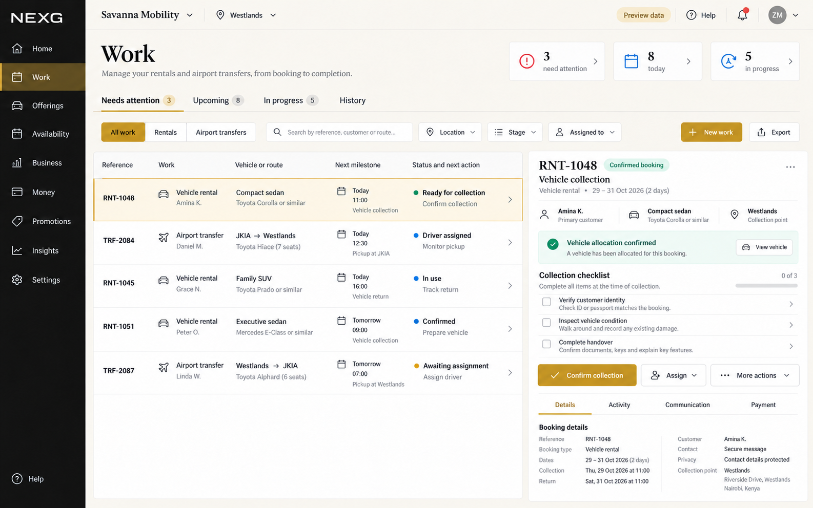
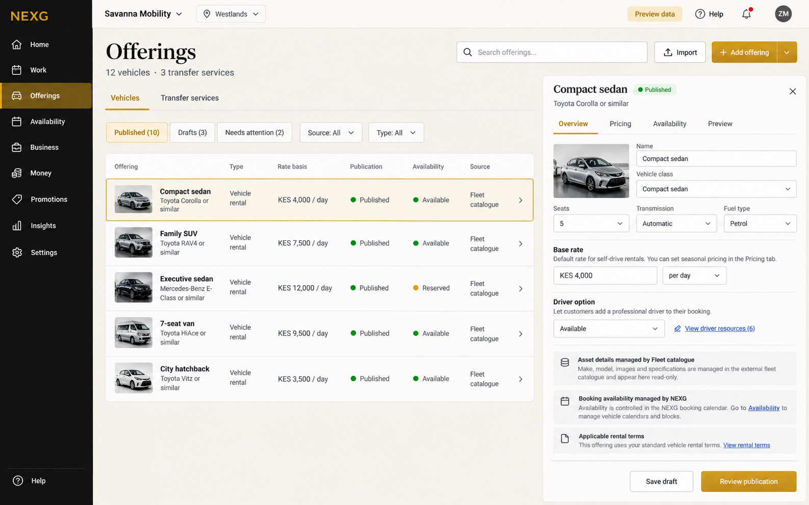
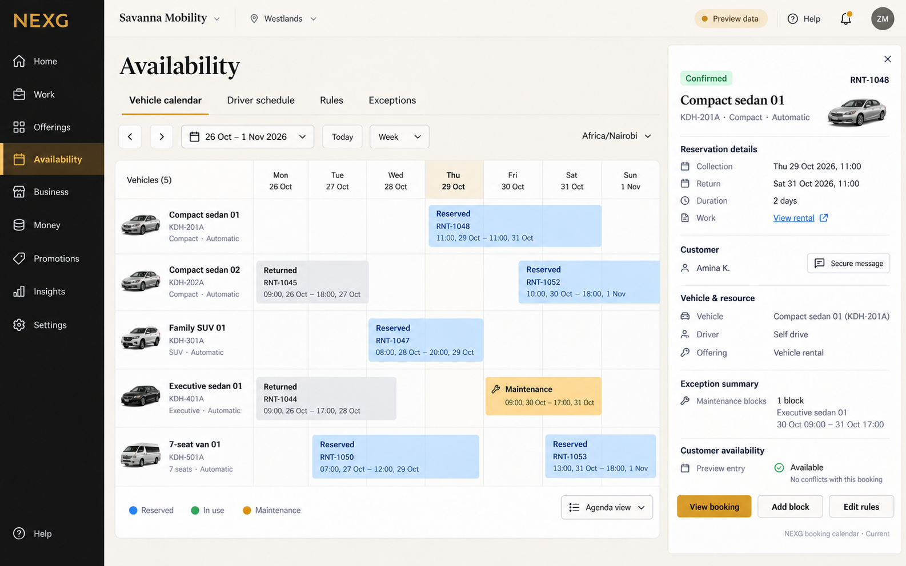
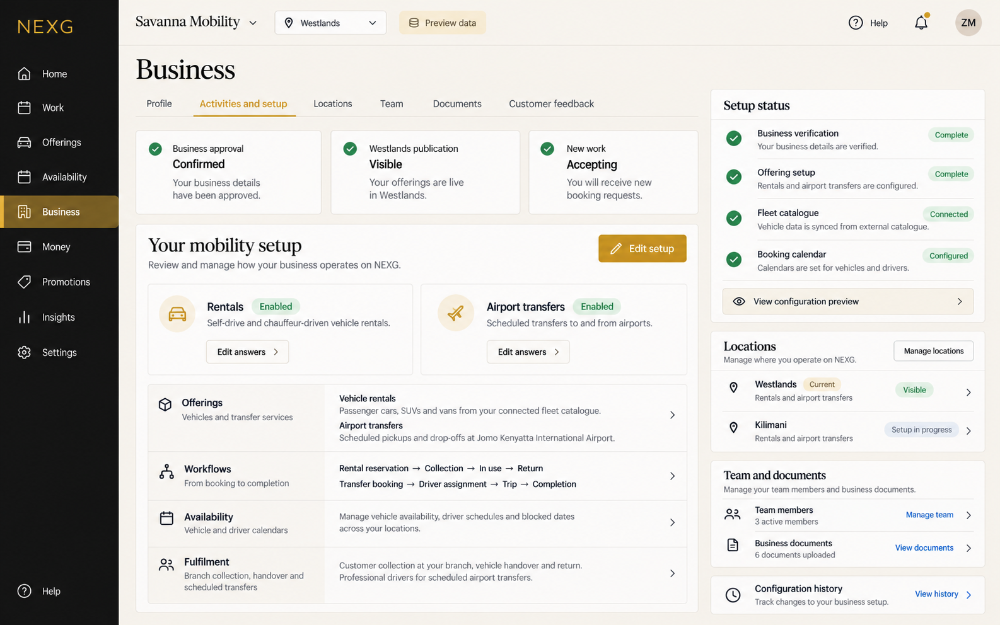
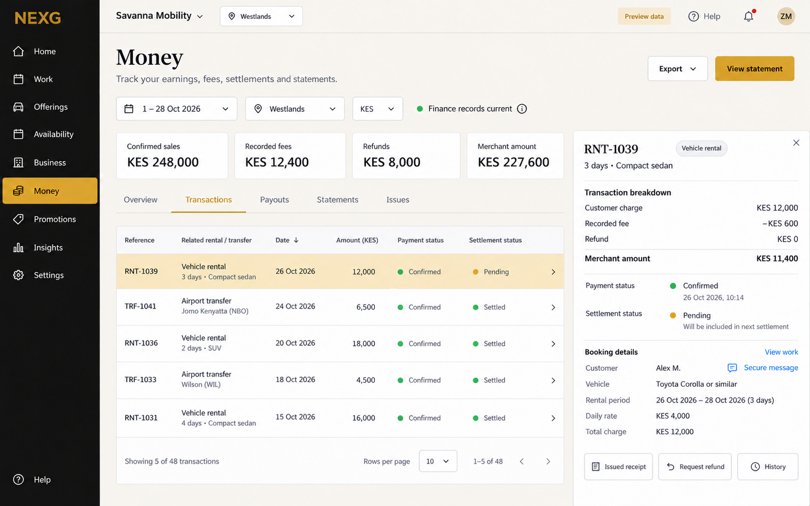
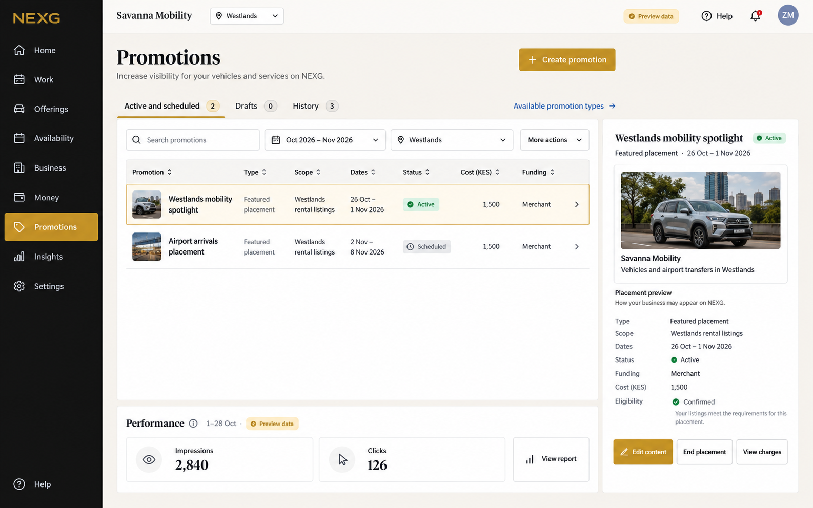
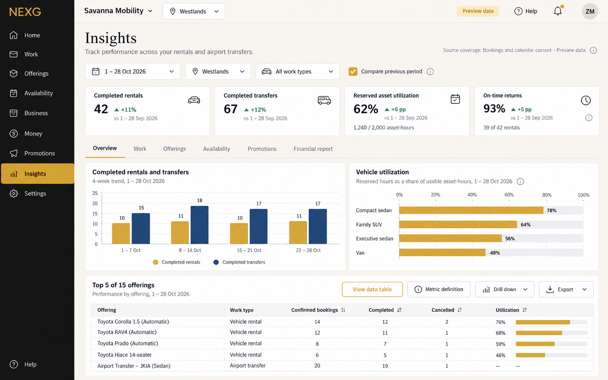
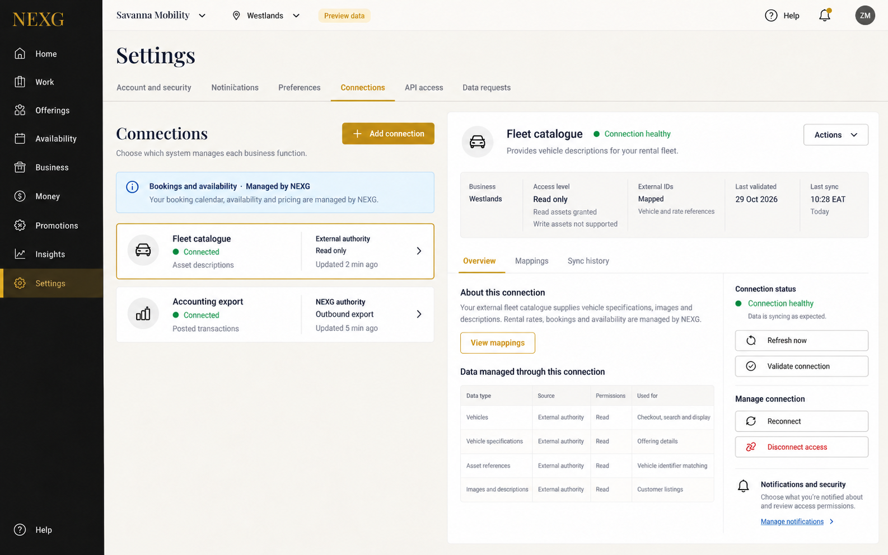

# Eight screen references

One selected final image per screen. Generated with the built-in imagegen tool after the onboarding/configuration and eight-screen design checks passed. Fictional preview data; these are raster references, not working application screens.

The fictional mobility merchant explicitly selected both rentals and airport transfers. Its example is one view of the common platform. The written [128-profile matrix](../profiles-128.md) specifies the other merchant configurations.

| Screen | Detailed specification | Final image |
| --- | --- | --- |
| Work | [Plan](../screens/01-work.md) | [01-work.png](01-work.png) |
| Offerings | [Plan](../screens/02-offerings.md) | [02-offerings.png](02-offerings.png) |
| Availability | [Plan](../screens/03-availability.md) | [03-availability.png](03-availability.png) |
| Business | [Plan](../screens/04-business.md) | [04-business.png](04-business.png) |
| Money | [Plan](../screens/05-money.md) | [05-money.png](05-money.png) |
| Promotions | [Plan](../screens/06-promotions.md) | [06-promotions.png](06-promotions.png) |
| Insights | [Plan](../screens/07-insights.md) | [07-insights.png](07-insights.png) |
| Settings | [Plan](../screens/08-settings.md) | [08-settings.png](08-settings.png) |

## Work

## Offerings

## Availability

## Business

## Money

## Promotions

## Insights

## Settings

Generation prompts: [image-prompts.json](../image-prompts.json). Selected output provenance and corrections: [image-manifest.json](../image-manifest.json). File checks: [image-verification.json](../image-verification.json).

The written specification governs required behaviour, state transitions, permissions, read-only controls and exact implementation. Raster text and example records are illustrative; pixels do not prove accessibility, operability or data-source execution. Only selected final images are included here.
