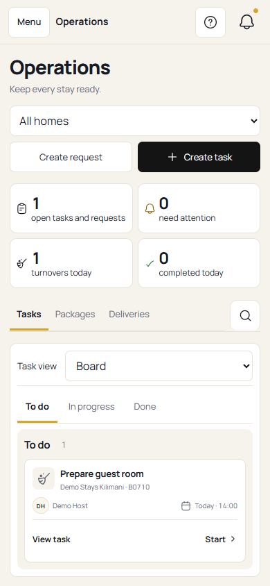
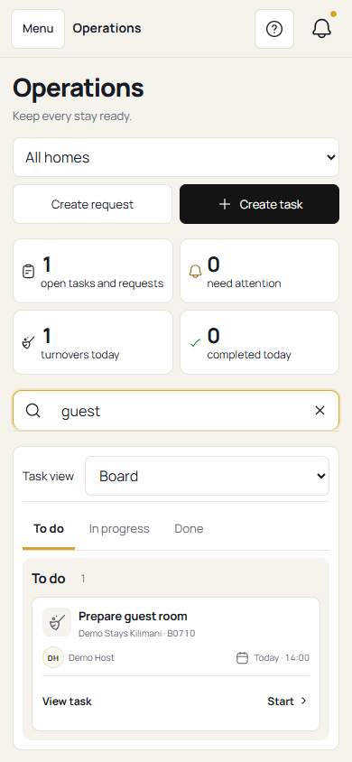
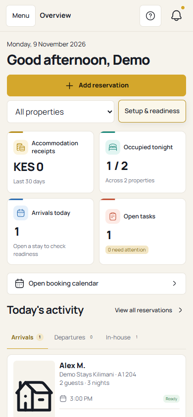
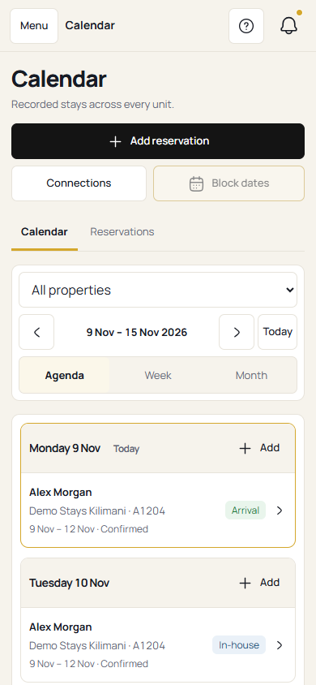
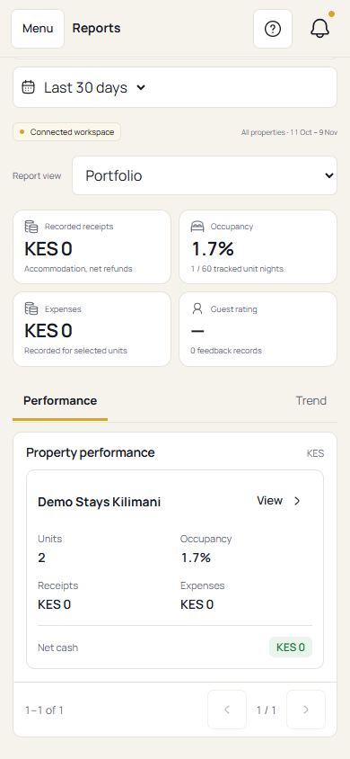
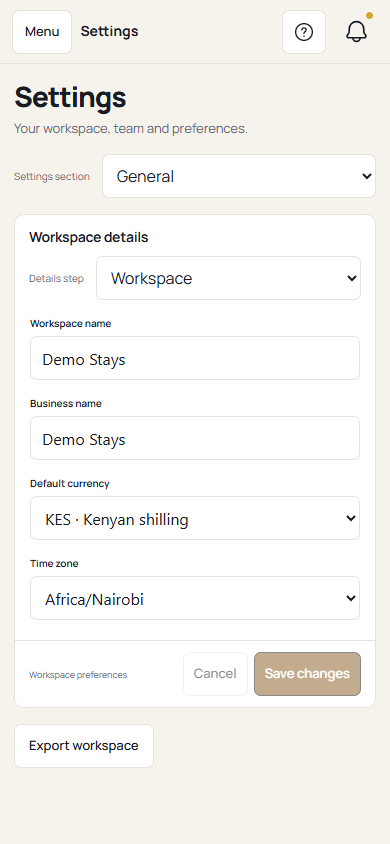
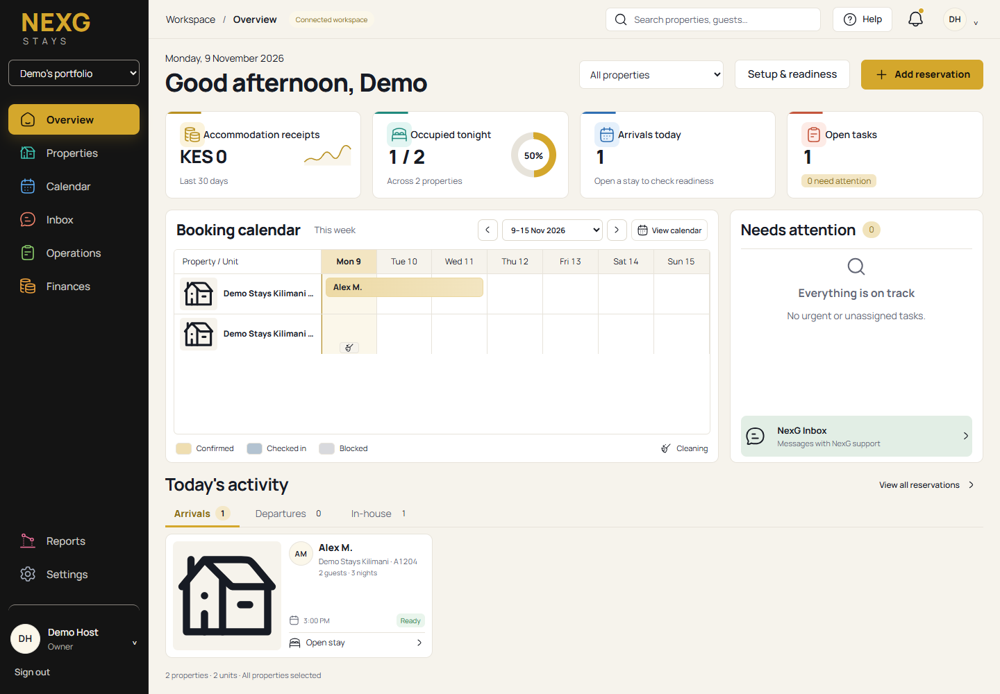

# Host workspace mobile adaptation

This change adapts the merged Host workspace for mobile web while retaining the desktop layout and existing record workflows.

## Changes

- **Navigation:** accessible phone drawer with focus trapping, Escape dismissal, focus restoration and inert background content. Touch targets and form text are sized for phones.
- **Overview and properties:** readable two-column metrics, stacked actions, content-driven sections, and a compact property-section selector. Today's activity appears before an empty attention panel.
- **Calendar:** phones open in a weekly agenda with reservation details and creation actions. Week/month grids remain available with intentional horizontal scrolling and a sticky unit column. Desktop still defaults to the week grid.
- **Inbox:** one pane at a time on phones, with working conversation navigation and browser history.
- **Operations:** compact view selection and content-driven task boards. Search starts as an icon on the right of Tasks, Packages and Deliveries. It expands into the same row on phones. Outside click, Tab or Escape collapses it without discarding the query. An active-filter dot and accessible label identify a retained filter. Clear resets the filter and returns focus to the input. Reduced-motion preferences are respected.
- **Reports and Settings:** phone performance cards expose every metric and the View action. Settings fields stack, currency names stay readable, and Save remains reachable without a fixed-height gap.
- **Finance:** cash-flow dates honor the selected period, bucket labels match their actual boundaries, empty periods show an explicit empty state, and fractional tick labels no longer round into duplicates.

The shell uses an 800px phone breakpoint. Existing management card layouts switch at 760px. Both boundaries are covered by responsive checks.

## Local verification

Use the repository's supported Node version and pnpm. Install root workspace dependencies with `pnpm install --frozen-lockfile`, then install the standalone Host frontend with `npm --prefix hosts-workspace ci --ignore-scripts`. The browser check uses the root `@playwright/test` dependency and an installed Google Chrome browser.

Run from the repository root:

```sh
npm --prefix hosts-workspace run typecheck
npm --prefix hosts-workspace run build
git diff --check
```

Start the preview in a separate terminal:

```sh
cd hosts-workspace
npx vite --host 127.0.0.1 --port 4178 --strictPort
```

Then run the responsive check from the repository root:

```sh
node scripts/check-host-mobile.mjs
```

The script uses a fixed date and synthetic Demo Host records. Host API requests are intercepted locally; mutation attempts cannot reach production. It writes screenshots and results to `hosts-workspace/test-results/mobile` by default.

Optional environment variables:

- `HOST_PREVIEW_URL`: preview URL, default `http://127.0.0.1:4178/nexg-hosts-workspace/`.
- `HOST_SCREENSHOT_DIR`: output directory.
- `HOST_CHECK_FOCUS=1`: skip the initial page/viewport sweep and run the interaction checks.
- `HOST_CHECK_MATCH`: run only checks whose description contains this text. For the new search interaction, use `Operations search`.
- `NEXG_PLAYWRIGHT_MODULE`: optional installed Playwright module location when the checkout does not have its own root dependency installation.

### Coverage

- Eight main pages at 320, 360, 390, 430, 768, 800 and 1440px, checking document/content overflow and page identity.
- Navigation focus/close/routing, calendar agenda/date/grid/modal flows, property search/sections, and inbox Back/Forward.
- Complete report cards, accessible Settings Save, finance empty/30-day/7-day/single-day states and exact bucket date labels.
- Operations search alignment, opening/focus, filtering, outside-click/Tab/Escape dismissal, retained queries, clear/refocus and tab switching at six widths.
- Long names, larger text, short phones, desktop calendar default and uncaught browser errors.

The full script contains 71 named checks. The Operations search check runs its interaction sequence at six viewport widths. The fixture suite is separate from the repository-wide CI workflow.

### Limits

These checks use Chromium with synthetic records, not a real iOS/Safari device or live backend writes. Repository-wide database, lint and end-to-end jobs are assessed separately in PR CI. The Host production build still reports the existing large-chunk warning. No merge or deployment is part of this change.

## Screenshots

These are actual local implementation screenshots, using synthetic Demo Host data. Mobile captures are 390 by 844px; the desktop comparison is 1440 by 1000px.

### Operations search

Collapsed beside the section tabs:



Expanded in the same row, with a retained query:



### Other mobile views









### Desktop comparison


