# Adaptive Insights image gallery

Twelve selected concept images, generated with the built-in image generation tool on 1 November 2026. All merchants, sources and figures are fictional review fixtures. These are pictures of proposed interfaces. They do not establish working controls, live data, approved calculations or accessibility compliance.

The [screen design](screen-design.md) governs behavior. The [coverage matrix](coverage.md) covers all 128 baseline subcategories and 21 approved additional routes across fifteen operational models. Different merchants reuse report components while retaining their own units, stages, evidence and permissions.

| Image | Question and scope |
| --- | --- |
| [01 Mixed overview](01-mixed-overview.png) | Product and appointment outcomes in separate activity sections. |
| [02 Product variants](02-product-variant-performance-v2.png) | Orders, item units, historical variants and promise-due measures. |
| [03 Appointments](03-appointment-performance.png) | Request confirmation, scheduled outcomes and usable provider time. |
| [04 Rentals](04-rental-utilization-v2.png) | Reserved versus actual use, asset-hours and exclusions. |
| [05 Event spaces](05-space-reservations.png) | Space-hours, compatible reservations and turnover/closure exclusions. |
| [06 Quotes and production](06-quotes-and-production-v2.png) | A request cohort followed separately from accepted production due work. |
| [07 Shipment operations](07-operational-milestones-v2.png) | Recorded on-time/late/unknown milestones and separate shipment/piece/mass units. |
| [08 Sessions and passes](08-sessions-and-entitlements-v2.png) | Dated place capacity and attendance, separately from rights and redemptions. |
| [09 Promotion attribution](09-promotion-attribution.png) | Qualified events, 30-minute tap attribution and unavailable value. |
| [10 Financial activity](10-financial-activity.png) | Currency-separated posted credits/debits with Money source links. |
| [11 Definition and evidence](11-metric-definition-and-evidence.png) | Explicit numerator, denominator, exclusions, version and contributing capacity groups. |
| [12 Mobile partial data](12-mobile-partial-data.png) | An incomplete appointment feed, disabled comparison and separately complete schedule evidence. |

## Mixed overview

The two business activities keep separate measures and charts. An evidence-backed observation opens the matching records. Activity configuration remains in Business.

## Products and variants

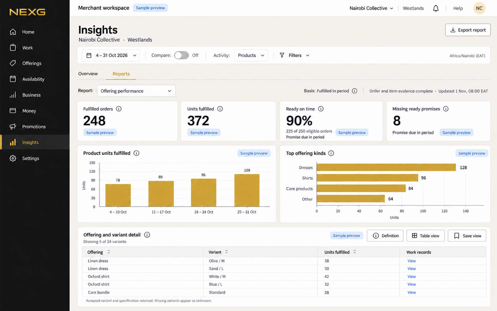

The same order report supports compatible retail and prepared-order variants. Product quantity and fulfilled order count remain different measures. Ready-on-time belongs to a separate promise-due cohort, specified in the written definition.

## Appointment administration

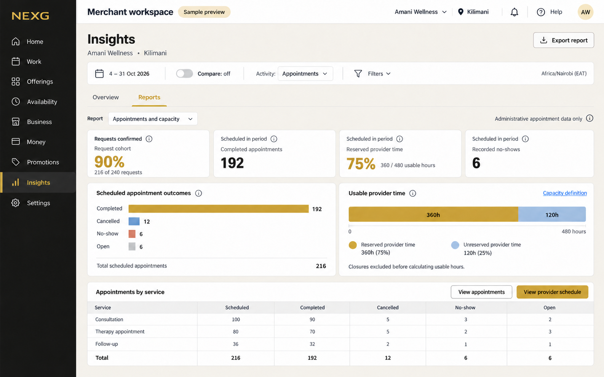

Request confirmation uses a request cohort. The scheduled workload table separately shows completed, cancelled, no-show and open appointments. Provider capacity requires actual usable schedule evidence. Health reporting remains administrative.

## Asset intervals

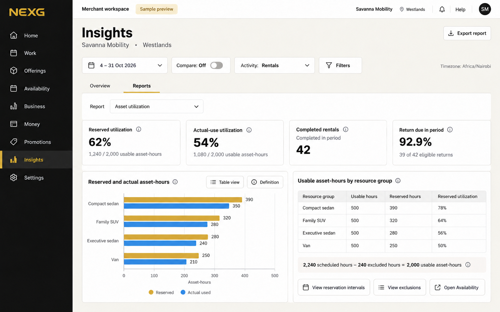

Reserved use and actual use have different evidence. Both use the same usable asset-hour denominator in this fixture. Maintenance and closure exclusions are inspectable.

## Tables and event spaces

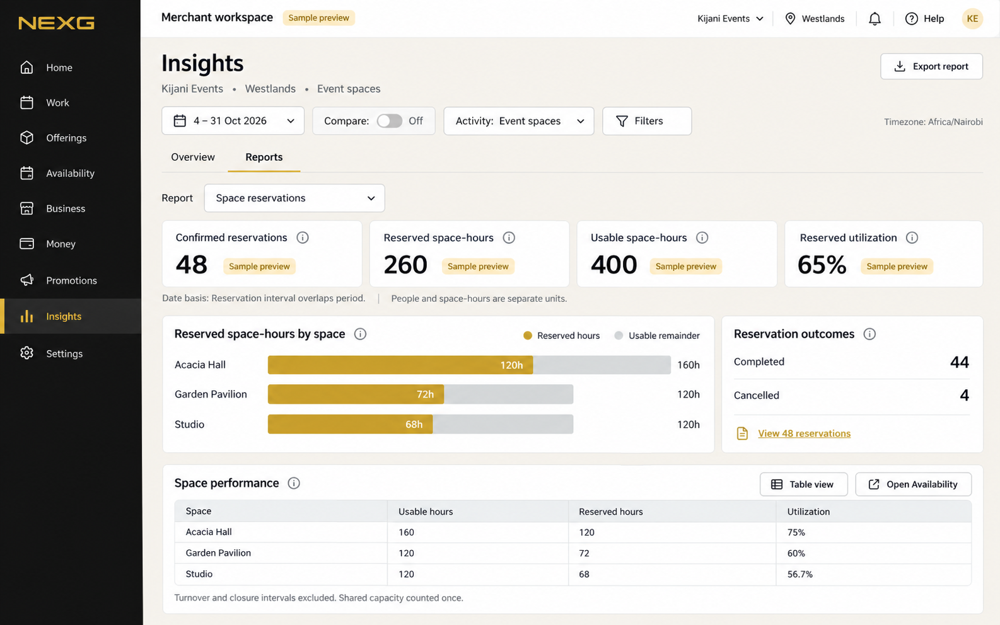

This selected event-space route is in the approved design additions. Table reservations reuse the interval concept with their actual table/party constraints. This image does not introduce hotel or overnight-stay capability.

## Requests, quotes and production

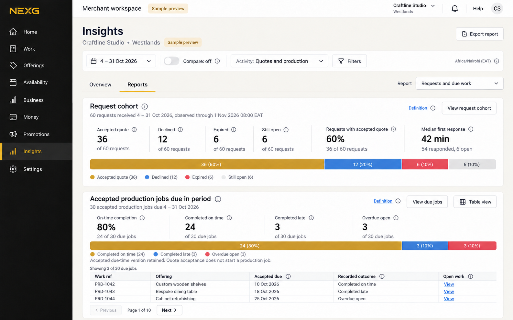

Requests with an accepted quote are 36 of 60 requests. Quote-decision acceptance on a quote-issued cohort is a separate measure. The 30 production jobs have their own accepted production commitments and due dates.

## Operational milestones

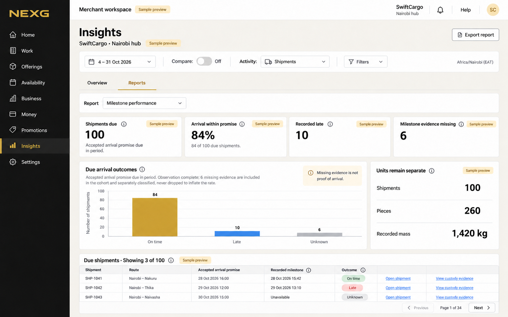

The selected view is freight. Field visits, transfers, linked collection/return, service jobs and storage have distinct report definitions in the coverage matrix. They do not inherit shipment arrival semantics, scans or units.

## Sessions, tours and entitlements

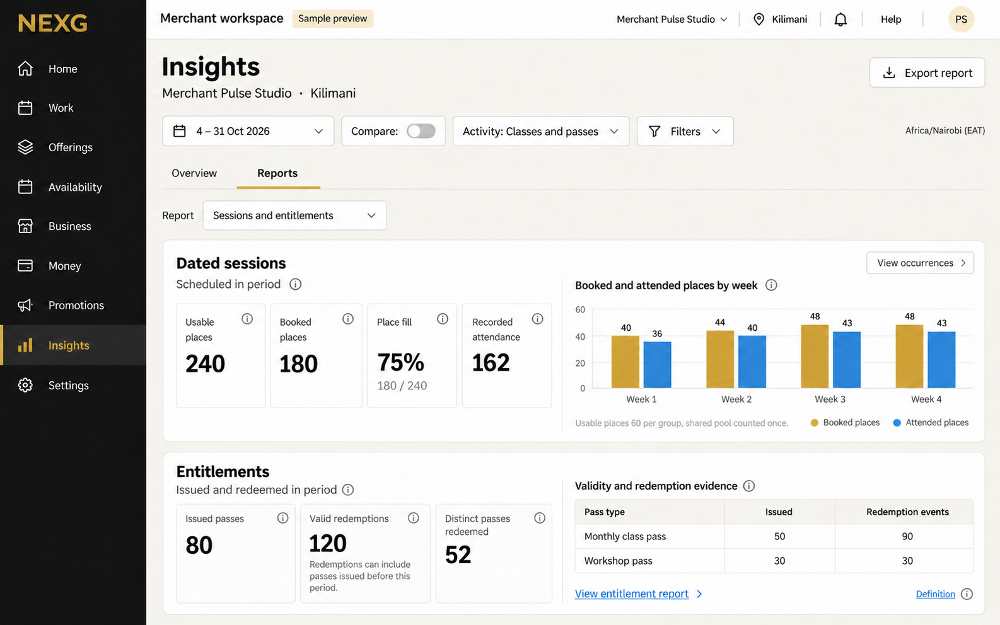

Dated session place reporting is separate from passes and their redemption events. Tours retain supplier/departure confirmation and their actual places/party constraints. A pass sale never establishes attendance.

## Campaign measurement

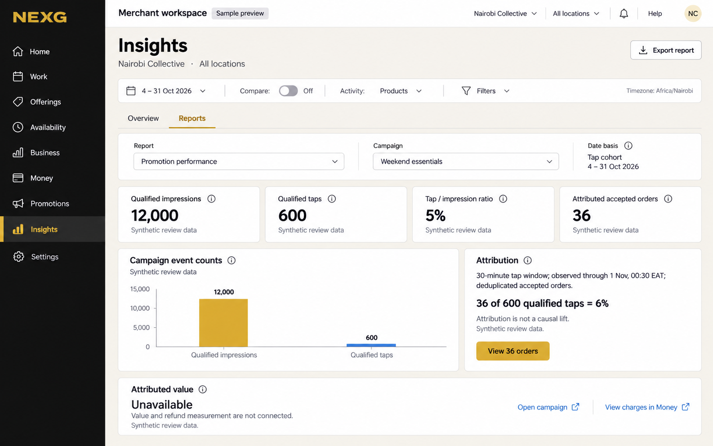

Synthetic event delivery illustrates an eligible tap cohort observed through the end of its 30-minute window. Attributed value stays unavailable. Neither causal lift nor ROI is inferred. Current runtime event ingestion is unproven.

## Posted financial activity

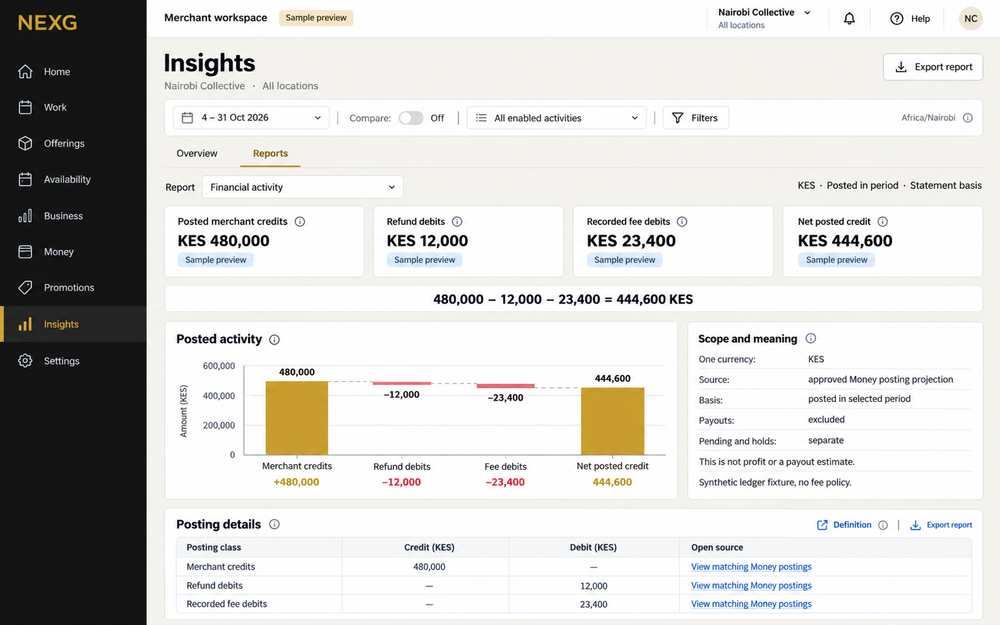

The illustrated posting classes reconcile arithmetically. A real implementation needs an approved Finance projection, all applicable posting classes, independent access checks and Money reconciliation. These figures set no tariff and promise no payout.

## Metric definition and contributing evidence

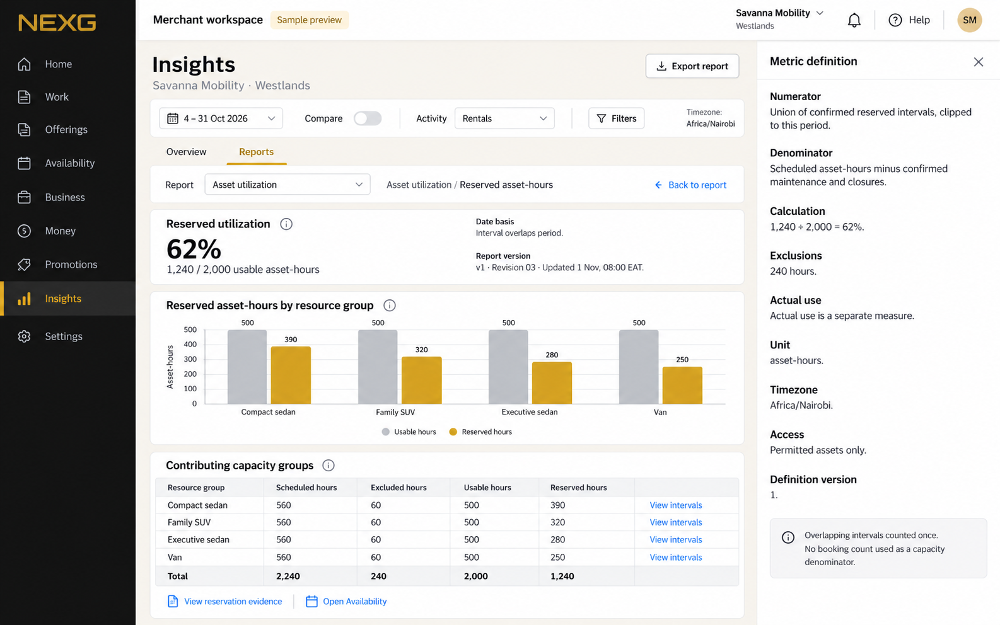

The 62% measure exposes 1,240 reserved asset-hours and 2,000 usable asset-hours. Group links lead to interval evidence in the proposed flow. Version, revision and exclusions make historical meaning inspectable.

## Mobile with incomplete data

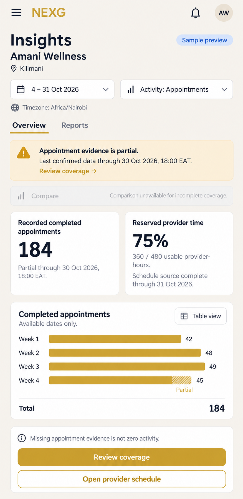

This is an alternative source-state scenario for the appointment merchant. The partially recorded 184 appointments are not the full-period 192 shown in the complete-source desktop fixture. The schedule source has separate coverage. Comparison is unavailable until the appointment evidence is comparable.

See [visual review and limitations](image-review.md), [initial prompts](image-prompts.json), [targeted corrections](image-corrections.json), [final refinements](image-refinements.json), [selected provenance](image-manifest.json) and [verification](verification.json). All twelve selected PNGs are saved alongside this gallery. Earlier variants remain available but are excluded from this selection.
