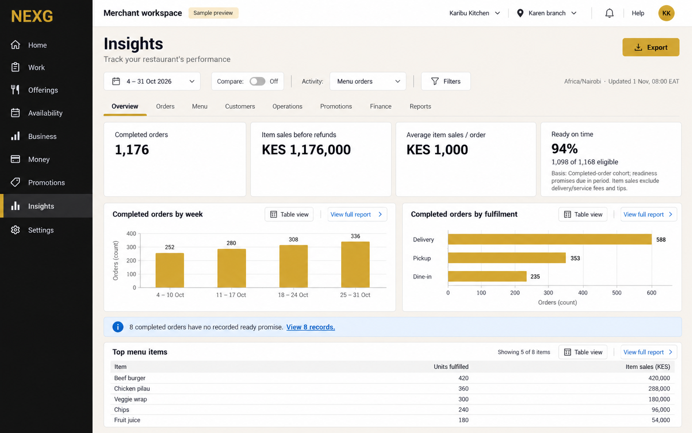
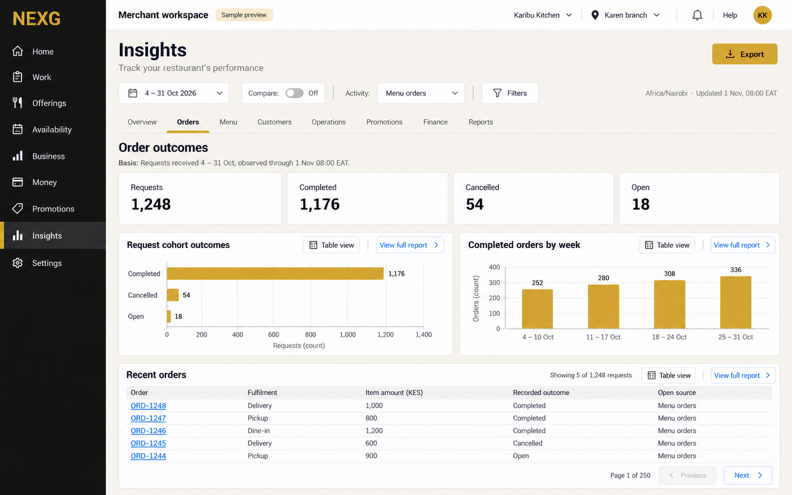
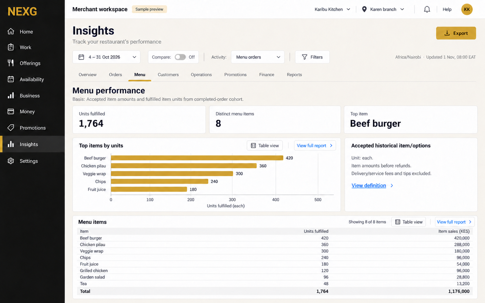
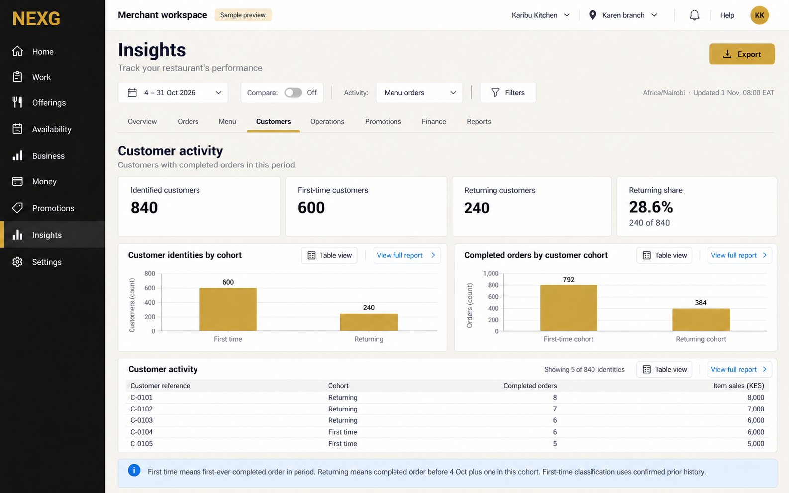
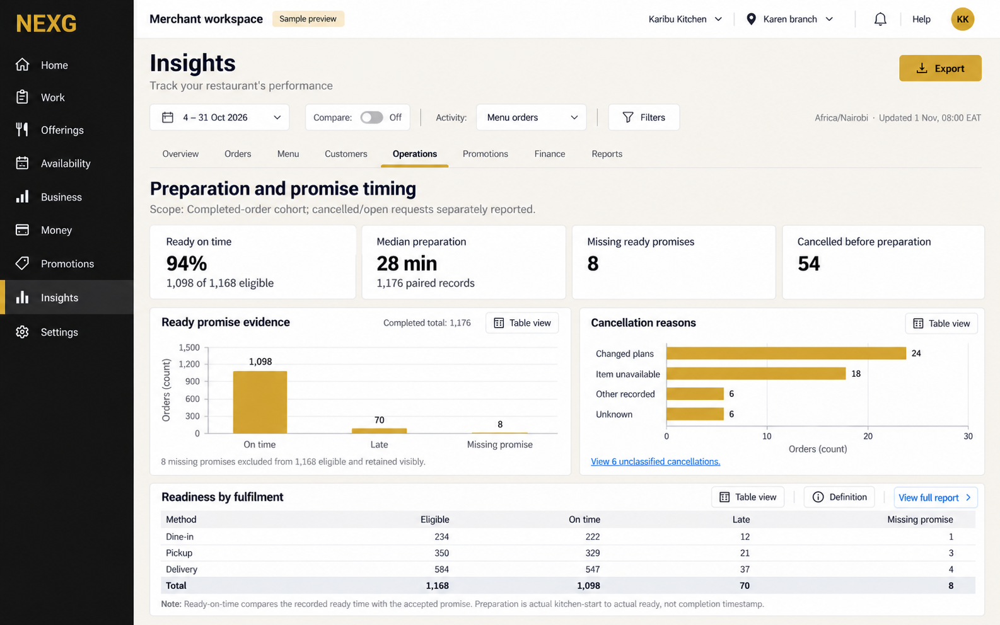
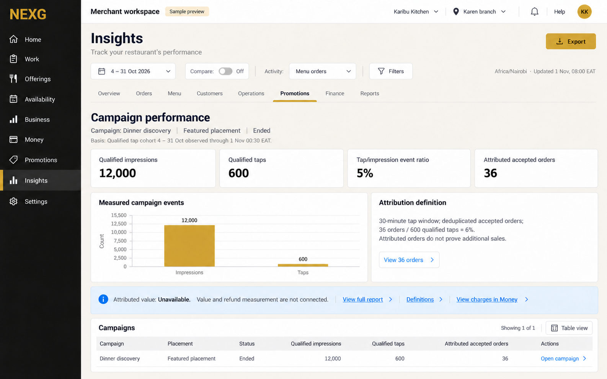
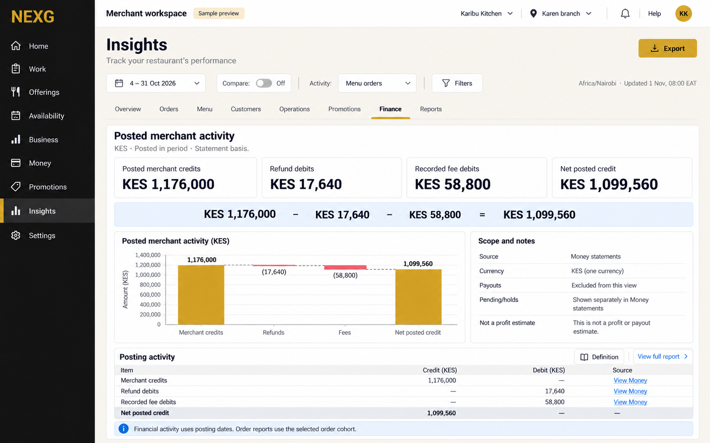
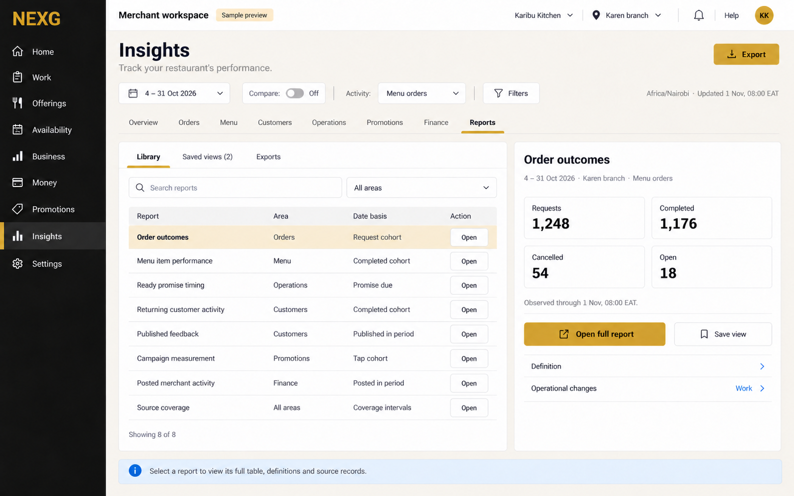

# Restaurant Insights gallery

Eight full-size selected concept screens for fictional Karibu Kitchen, Karen branch. All share one reporting period, one sample fixture and the same eight peer tabs. Generated with the built-in image generation tool on 1 November 2026.

| Screen | What it demonstrates |
| --- | --- |
| [Overview](01-overview.png) | Completed orders, item sales, readiness and top menu items. |
| [Orders](02-orders.png) | A request cohort, completed/cancelled/open outcomes and source records. |
| [Menu](03-menu.png) | Distinct menu items, fulfilled units and accepted item amounts. |
| [Customers](04-customers.png) | First-time and returning customers, with a defined history and separate order counts. |
| [Operations](05-operations.png) | Preparation timing, eligible promises, missing evidence and cancellation reasons. |
| [Promotions](06-promotions.png) | Measured campaign events, defined attribution and unavailable value. |
| [Finance](07-finance.png) | Posted merchant credits/debits, with payouts and pending activity separate. |
| [Reports](08-reports.png) | Searchable Library, Saved views and Exports, plus the selected report preview. |

## Overview

## Orders

## Menu

## Customers

## Operations

## Promotions

## Finance

## Reports

All figures are fictional. The pictures demonstrate the proposed design; controls and calculations have not been executed in a working application. [Fixture and definitions](fixture.json), [generation prompts](image-prompts.json), [visual review](image-review.md) and [verification](verification.json) are saved alongside the images.
