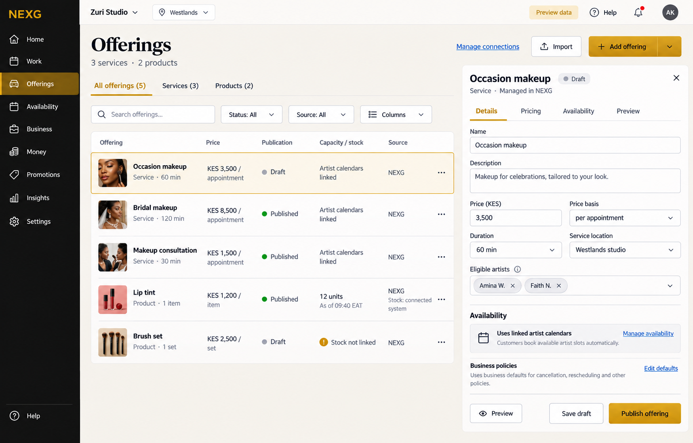

# Offerings: component audit and general screen concept

The frontend implementation now lives in [the working Offerings component](../../../apps/web/components/merchant/offerings/README.md). The audit and image below remain the original design record. See [the implementation brief](implementation-brief.md) and `implementation/` for current frontend verification; live integrations and onboarding are outside this implementation.

Date: 31 October 2026. Design review only. No frontend, booking engine, API or Supabase changes. One new selected screen image follows the completed audit.

## Result

All 128 subcategories have an offering-editor foundation. They reuse the catalogue, source-aware fields, pricing, publication, preview and editor containers. The 17 primary offering schemas cover the current 128 primary profiles; the current reconciled domain additionally registers `SPACE_RESERVATION_V1`. The screen therefore needs 18 supported editor contracts, not 128 separately built pages.

The current reconciled question/profile/workflow/domain snapshot in `docs/booking-engine/payload-reserve-plan/reconciliation/manifest.json` is inspected together. Its 15 booking models are not the same thing as the 18 offering schemas. The older portal profiles provide traceable primary editor references; their conditional rules must not be replayed alongside effective rules. The latest user instruction in [automatic confirmation](../order-confirmation.md) overrides conflicting inherited intake metadata: standard stock/resource-confirmed work proceeds automatically, with human judgment limited to explicit matched exceptions.

See [all 128 bindings](coverage-128.md), [structured audit](coverage-128.json) and [verification](verification.json). These establish design-reference coverage, not proof that the frontend already renders those variants.

## Shared screen and components

| Component | Shared behavior | What adapts |
| --- | --- | --- |
| Catalogue and type views | Search, sort, status/source filters, stable row identity, selected detail, applicable bulk actions | Merchant vocabulary, relevant type views, columns, price basis, stock/capacity summary and customer action. Only types actually enabled for this business appear. |
| Identity/media | Name, description, useful media, tags and discovery grouping | Listing-specific attributes, variants and customer descriptors. Photos stay optional; asset/resource identities stay separate from listing identity. |
| Typed fields | Visible labels, units, requiredness, dependencies, validation and inherited values | The selected schema and effective scoped questions determine the fields. Do not ask every onboarding field on every listing. |
| Price/unit editor | Currency, typed amount, unit, price authority and supported options | Per-item, measured weight, time, person/place, rental period, recurring entitlement, package or quote. Quote/enquiry is never displayed as a zero-price item. |
| Source ownership | Field provenance, confirmed value/time, local/remote edit policy and sync state | Details, price, stock and schedule can have different owners. A connected stock source does not automatically own the listing's description or prices. |
| Availability/resource links | Link to the applicable scheduling/stock owner and show relevant setup | Stock counts, staff slots, asset intervals, dated session places, compatible spaces, cargo limits or storage quantities. Published does not mean currently available. |
| Fulfilment/policies | Relevant methods, places, instructions and terms references | Delivery/collection, customer visit, remote session, rental handover/return, transport legs or provider handoff. A driver option does not create a transfer business. |
| Publication/preview | Draft saving, customer preview, validation, permitted publish/unpublish, version history | Customer CTA is Buy, Book, Reserve, Request quote or Enquire according to the actual offering. Listing publication review is separate from incoming-order approval. |
| Detail/editor | Selected row, grouped fields, close/back with focus return and draft preservation | Full-page editor on small screens; readable detail pane on desktop. Advanced fields remain reachable through relevant sections. |

## Specialist editor contracts

| Editor | Main specialist fields or components |
| --- | --- |
| Product/menu | Sale unit, SKU/variant, modifiers, stock link, preparation only when relevant, measured quantity and actual product attributes. |
| Made to order | Specification, proof/approval only where required, materials, production duration and agreed due promise. Fixed published variants need no invented blanket merchant acceptance. |
| Appointment | Exact duration, eligible staff/resources, venue/customer-location mode, buffers and linked calendar. |
| Remote session | Exact duration, eligible provider, permitted remote channel, access and deliverable reference. No clinical content. |
| Field service | Service scope/area, team eligibility, duration/travel policy and completion evidence. Business service area is inherited unless a scoped override is allowed. |
| Rental | Asset class or explicitly selected asset, period/unit/rate, eligible resources, handover/return and terms references. Asset class is not a single vehicle. |
| Transfer | Route/coverage, pickup/drop-off intake, passengers, vehicle/driver or greeter requirements as appropriate. |
| Event admission | Event/session, admission-place quantities, price basis, issuer link and check-in relationship. Publishing a listing does not issue tickets. |
| Group session | Dated session, participant places, instructor/equipment needs, duration and recurrence as a schedule rather than assumed membership. |
| Tour | Package/itinerary, departures, party/places, supplier/guide/vehicle dependencies and actual booking/request mode. |
| Request/quote | Scope/intake, named response owner, quote terms and customer request/approval flow. Special sourcing is not automatically custom manufacturing. |
| Pickup/return | Service class, per-item/weight/bag units, intake measurement, processing, collection and return windows. |
| Membership | Entitlement, validity/usage units, included benefits and renewal policy. Recurring appointments alone do not create a membership or debit. |
| Freight | Cargo/route, dimensions, mass/volume in separate units, rate/quote basis, documents and custody references. |
| Storage | Physical space unit, storage location/capacity, billing period, intake/access/release and partial release. |
| Regulated enquiry | Permitted service information, administrative enquiry fields, provider reference and handoff. No customer bank balance, remittance execution or clinical record. |
| Service job | Intake/assessment, scoped fixed/quoted work, parts, quality and handover. Optional appointments stay possible when advance booking is not mandatory. |
| Table/space reservation | Compatible tables/spaces, party-size rules, duration/turnover and shared capacity. Physical seating or Wi-Fi alone does not create bookable capacity. |

## Refinements completed before the image

1. **Scoped inheritance:** fleet size, business claims, service areas, default policies and resource rosters are not repeated as required fields for each listing. Display inherited values with a relevant setup link; expose per-offering overrides only when the typed definition allows them. Existing bookings retain their accepted revision.
2. **Space editor:** explicitly include tables, workspaces and compatible-space allocation even though none of the original primary profiles uses this as its only editor.
3. **Separate status axes:** publication, actual stock/slots/capacity and source health have separate meanings. A Draft listing can have configured capacity; a Published listing can be sold out. A disconnected feed is unknown, not sold out.
4. **Per-field authority:** show owned fields as editable and externally owned fields as read-only or as a supported remote change with pending confirmation. Never show editable fields under a claim that the external system owns them.
5. **Confirmation:** no Accept/Decline order queue belongs in Offerings. Normal source-backed orders/bookings use automatic confirmation. Publication validation is a listing/configuration task.
6. **Selected offering controls composition:** multiple business activities do not turn every listing into all those types. A product sold by a service business uses stock, while its appointment uses staff capacity.

## States and validation

The [Offerings screen specification](../screens/02-offerings.md) defines OF01–OF25, inherits R01–R12/A01–A10, and remains the interaction inventory. The component audit adds concrete obligations:

- First use offers applicable Add/Import/Connect; filtered-empty retains active filters and Clear.
- Missing price, unknown stock, no slots, unpublished, scheduled publication, paused listing and unsupported operation remain distinct.
- Import previews IDs, mapping, duplicates, field ownership and per-record changes. Partial success does not erase other offerings.
- Saving validates typed units, required attributes and field ownership. A source-owned field cannot become editable just because a local owner opened it.
- Stale/conflicting/unmapped sources preserve permitted confirmed data with source state and recovery; they never imply a confirmed saleable quantity.
- Duration/resource/term changes preview their effect on future commitments while preserving historical terms.
- All specialist editors retain mobile/keyboard access, labelled error recovery and a meaningful customer preview.
- New categories reference supported typed editors, scoped fields and components. Unknown component/schema references require an explicit extension before activation.

## The one image

Selected image: [offerings-general.png](offerings-general.png). Generation tool: built-in imagegen. Exact generation brief: [image-prompt.txt](image-prompt.txt). Visual inspection: [image-review.md](image-review.md).

The image is one coherent, fictional **Zuri Studio** merchant with makeup appointments plus explicitly enabled product sales. It demonstrates the shared catalogue, service/product rendering, distinct publication and capacity/stock summaries, source-aware information and a selected service draft editor. It is not a collage of all 18 editors.

Use the existing NEXG dark sidebar, cream workspace, white surfaces, restrained gold, compact sans-serif UI and nine navigation destinations. Preserve useful density and readable hierarchy. Search, type/status/source filters, Add, Import, connection access, row actions, editor sections, customer preview and Save/Publish are visible or reachable. Only the applicable editor is open; every dialog is not opened at once.

The selected draft service has a known price/duration and linked artist capacity, so Save draft and Publish offering are appropriate. Another service can be published, while a product shows external stock and a separate draft product lacks stock setup. All values are prominently identified as preview data.

The previous [Offerings picture](../images/02-offerings.png) is a style reference and historical draft. Its externally managed asset fields appeared editable, so it is not the authority for field editability. The new selected picture is saved separately and is the single current reference for this review. The existing Home preview was not running during the read-only reference check; no server was started and its UI was not changed.

## Remaining implementation proof

The image establishes visual direction. Build-time acceptance must render every named specialty, its effective offering/method variants, source/role combinations, state recovery and a future category. The actual application has not been built or tested for those interactions by this design/image task.
