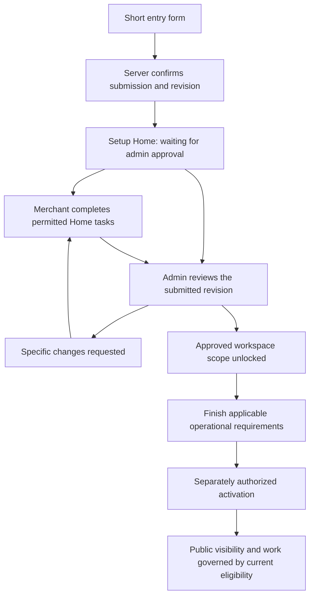

# Onboarding, setup Home and merchant approval

Date: 1 November 2026; amended 2 November 2026, Africa/Nairobi. Status: P0 rules specified; P1 shared configuration, P2 short registration, P3 shared Home/frame, P4 local backend foundation, P5 saved Home and P6 existing-admin review are implemented with focused local verification. Configured Auth, deployed schema and runtime acceptance remain open; connected registration remains feature-disabled. See [Phase 6 acceptance](phase-6-acceptance.md), [Phase 5 source and runtime limits](phase-5-acceptance.md), the [Phase 4 rollout limits](phase-4-rollout.md) and the [current handoff](../../handoff/HANDOFF.md). Phase 7 activation/source connections and final email OTP follow. The [Phase 2 short form](phase-2-short-form.md) remains the entry design.

Workspace: `C:\Users\limta\Desktop\MERCHANT WORKSPACE`. The Documents checkout is a historical copy and is not the implementation target.

[Phase 4 source and payout inputs](phase-4-existing-systems-and-payouts.md) records the earlier research. The [implementation contract](phase-4-implementation.md) and [rollout record](phase-4-rollout.md) describe the implemented private Till/PayBill/bank editor, durable application contracts, access/session safeguards, existing API hardening and vendor-neutral connector foundation. No provider or production connection is claimed.

## Outcome and confirmed direction

The merchant completes a short entry form, submits it and lands on the existing setup Home. Home uses their saved business information and offers guided tasks for anything they skipped. While admin approval is pending, Home and its permitted setup tasks remain usable; operational sections are visibly blurred and locked with **Waiting for admin approval**. Approval unlocks the approved workspace scope. It does not automatically publish the merchant or allow customer work.

The user explicitly selected this journey and then requested that the form be as simple as possible. The final Phase 2 direction limits registration to the six basic business/contact/category groups; if information can be entered in the portal, defer it to Home. Existing detailed sections remain as Home task editors, with unfinished information retained. Email OTP is deferred until the end. The supplied Home screenshots establish the target layout, not a requirement that every merchant starts at three completed steps out of seven. The Glovo screenshots establish a simplicity/field reference, not a complete external service policy.

The original audit and build order below remain the planning baseline. Authorized implementation now includes saved application/owner records through actual merchant Home, onboarding-only demo entry and rejected-application recovery. No service was started for Phase 5. The existing Next endpoint on port 3000 responds; `/merchants/register` shows the deliberately disabled real-registration gate and the demo entry. This observation does not establish the authenticated configured journey. No production approval, deployment or email OTP is claimed.

## 1. What the audit found

The supplied form is a useful prototype. It covers the same 21 category names and 128 specialty labels, has repeatable offerings, conditional packaging, Kenya phone handling, file size/type hints and an explicit distinction between submission and approval. It also avoids storing sensitive identity answers in browser local storage.

It is not connected to the current workspace contracts. These are the material gaps:

| Finding | Why it matters | Planned correction |
| --- | --- | --- |
| Independent category definitions; category IDs use different spelling and specialties are label-valued | Matching counts do not produce matching records. `app-services` also needs an explicit semantic mapping to the existing concierge category | Shared canonical IDs and an explicit legacy import map. Never derive IDs from display labels |
| Short category-level fields rather than effective specialty questions | A mixed retail/service business cannot express the current activity, source, offering and capacity rules | Reuse the effective typed registry and compiled configuration; render only questions relevant to the selected scope |
| All six form steps must pass before submission | It prevents the short entry form the user wants and duplicates Home's later setup tasks | Small entry requirement set; everything else is an optional guided task, with separate review and activation requirements |
| One location, one timing model and one booking configuration | Retail, appointments, remote work and several locations cannot be represented faithfully | Scoped activities, places, offerings, schedules and resource references |
| Existing systems and record authority are absent | The workspace cannot know which system owns stock, bookings, pricing or payments | Optional source discovery and later connection tasks. A vendor declaration never creates a connection |
| Universal operating address, same-day hours and some universal document requirements | Digital, enquiry-only and overnight operations are forced into irrelevant answers | Applicable place/schedule/evidence rules; fixed Kenya zone; explicit unknown values |
| Prices become JavaScript floating-point KES values | Shared typed prices and units cannot be preserved reliably | Integer minor units, currency and declared pricing unit; quote pricing remains separate |
| Files remain in component memory; draft loading is absent | Refresh loses files and upload state; metadata is not a durable upload | Reuse private document storage and durable references, server drafts and resume loading |
| Placeholder save/submit URLs and local submission status | A success message does not produce a real application, Home state or admin case | One authenticated application/configuration source and a confirmed-submit-to-Home response |
| Home's review state is preview-only; the screenshot uses a fixed sample | Production cannot truthfully show pending approval or saved progress through a redirect alone | Real review/access view model, shared shell and calculated requirement rows |
| Current SQL readiness still assumes delivery zone, prep time and five items | The current server would contradict the new form and adaptive Home | Replace universal thresholds with applicable, owner-confirmed requirements |
| Existing admin go-live also publishes the merchant | It cannot safely serve as the requested approval/unlock action | Separate approval/access decision from activation/publication |

The audit also found smaller form defects: missing `offerLabel` and `afterApproval` configuration properties, destructive category changes, silent reassignment after removing a specialty, page-position progress and developer-facing product copy. Fix these during form adaptation, with a recoverable change review rather than discarded answers.

See [the source and evidence register](evidence.md) for inspected files and exact locations.

## 2. Keep entry short; complete setup from Home

### Minimum entry

The [Phase 0 entry table](phase-0-rules.md#2-entry-field-rules) defines basic business/contact information, branch count, registration declaration, category and at least one subcategory, plus actual required policy acknowledgements. Reuse existing identity and membership services. Do not create a second login system. A contact typed into a field is not proof of contact ownership or legal ownership of the business.

Category/subcategory selection is required for new submissions following the user's latest clarification. Those IDs select the starting portal configuration. Existing incomplete/imported drafts may still have an explicit **activity not configured** state; preserve them and request selection without a restaurant default. Operational capability/readiness remains unresolved until its actual Home tasks are completed.

Keep optional marketing separate. Phase 0 defines the field baseline; actual policy document references and the existing identity verification behavior are validated against their owner services before integration. Business/person presentation is deferred to the final pass, while their records and authorization stay separate now.

### Entry form presentation

Use a short primary path:

1. **Business and contact:** a single short form with the Phase 0 basics, canonical category/subcategory chooser and separate policy/optional communication choices.
2. **Verify and submit:** reuse required existing contact verification, confirm the saved basic application, then open Home. Do not imply approval, connection, payout verification or public visibility.
3. **Complete setup from Home:** retain the existing offering, place, operating, document and payout sections as Home editors only. They are absent from startup registration. Missing or unfinished operational values cannot block the short entry contract. After actual OTP verification and sign-in, applicable setup requirements become visible through Home; admin approval is independent.

Typed optional fields may still be validated if the merchant supplies them. An unfinished optional group can remain a draft instead of blocking entry. Explain invalid entered values without silently dropping them. Unknown is distinct from false, zero, unavailable or not applicable.

### Where deferred information goes

| Home group | Saved registration/Home information reused | What completion actually means |
| --- | --- | --- |
| Business profile and activities | Name, identity declarations, specialties, activities and relevant places | Required information for the applicable scope is saved and valid. Show verification separately |
| Hours, availability and resources | Opening hours, appointments, dated sessions, assets, staff and exact time/capacity rules | The selected activity has the applicable schedule/resource facts. No universal preparation timer |
| Team and devices | Owner responsibility, optional team and device setup | The business has its required responsible actor/device arrangement. A solo owner does not need a fictitious teammate |
| Offerings | Products, services, rentals, requests, imports and pricing | Applicable first usable offering/import/request setup. No universal five-item threshold |
| Documents | Relevant evidence and durable upload references | Uploaded, scanning, under review, verified, changes requested and expired remain distinct |
| Payout method | Declared method and private account reference | Supplied and verified remain distinct; apply an actual owner/provider requirement before activation |
| Connections, where relevant | Existing systems, intended authority and supported import/connection methods | Authorization and supported operations are confirmed. Selecting a vendor is not completion |
| Readiness and go live | All applicable confirmed prerequisites | Admin/business approval, operational readiness and the separately authorized activation decision are satisfied |

Preserve the screenshot's greeting, three-part status strip, checklist, location summary, help and black/cream/gold shell. The seven familiar groups can remain the visual foundation, but the applicable tasks, labels and denominator must adapt. Enquiry-only businesses do not receive a mandatory test order. Connections can be a relevant task within the appropriate group rather than a forced extra entry screen.

The same task opens the same editor and saved record whether accessed from onboarding, Home or the unlocked destination. Do not re-enter an address, offering or account already supplied.

### Requirement rules

Each requirement needs an ID/version, business/location/activity scope, applicability, reason, current evidence, responsible actor and authorized next action. It also declares when it is required: entry, review decision, activation, or optional. These are distinct gates, not one universal `required` flag.

Progress is calculated from that same applicable requirement list. Pending admin/provider work is labelled as waiting, with no suggestion that the merchant can finish it by clicking. Submitted evidence is not marked verified. The screenshot's 43% is never copied into a real account.

Review may begin on an incomplete application. Admin can approve the permitted account scope when that review's minimum evidence is met, or request the exact missing information. Skipped operational details remain Home tasks and continue to block only their relevant activation. A truly required review fact must be requested explicitly rather than converted into a fabricated default.

## 3. Submission, approval and access

### Pending Home and blurred portal

- Home is readable and usable. Show **Waiting for admin approval**, the saved application reference, its current status, remaining tasks and support.
- Home setup editors remain available for the merchant's permitted draft details, documents, offerings, payout setup and requested corrections. These edits do not perform live transactions, publish records or grant access to the rest of the portal.
- Keep the nine workspace destinations visible. A restricted destination shows a safe blurred placeholder with a clear approval message and **Back to Home**. Do not load operational or sensitive real data underneath CSS blur. The lock applies on desktop and phone.
- Keep status, application summary, correction/resubmission, help/support and sign-out/account recovery accessible. Do not blur the explanation or trap keyboard focus.
- Restricted controls are inert and cannot receive focus or trigger writes. Routes, queries, server actions, RPCs, table policies, files and exports enforce the same access policy. Disabling navigation alone is insufficient.
- An unknown review result stays locked with a recovery action. It never defaults to approved.
- After an approved decision is confirmed, Home and navigation refresh from the server, including on reload and another authorized device. Approval of one location/activity does not implicitly approve all others.

### Keep these facts separate

| Fact | Meaning and authority |
| --- | --- |
| Application review | Draft, submitted, under review, changes requested, approved or rejected/declined where supported, bound to reviewed evidence/revision |
| Workspace access | Pending/restricted or permitted approved scope, decided by server policy |
| Setup readiness | Applicable requirements, evidence and unresolved tasks, derived from owner records |
| Public visibility | Whether the business/location/offering is actually published |
| Accepting work | Current authorized willingness plus capability, schedule, capacity and source eligibility |
| Document/payout/connection verification | Independent owner-confirmed states, with revision and failure/unknown handling |

The application state names above are the P0 target model to map to existing statuses in P1. They are not a second independently maintained status list. Prefer a dedicated review/access record over overloading legacy `merchant.status`; settle the persistence decision before migration.

Admin approval removes the approval lock only. It does not set `live`, verify every file, verify a payout account, connect an ERP, create stock or resources, or switch accepting work on. Activation remains a separate explicit command. Ordinary source-confirmed customer orders/bookings remain automatic under the existing policy; admin approval of a merchant is a different process from exceptional review of customer work.

## 4. One contract across the form, Home and admin

Use the existing merchant identity and `merchant_user` ownership. Draft creation already creates these together. Preserve current entity IDs and history; do not duplicate merchants when connecting the standalone form.

The contract package must represent:

- Application/merchant identity, owner scope, review/access state, configuration revision and submission result.
- Canonical category/specialty/activity IDs and optional typed answers with question version, scope and provenance.
- Pinned taxonomy, effective question/profile/model and requirement versions.
- References to actual locations, offerings, resources, uploads and protected payout records. Keep secrets outside general configuration JSON.
- A deterministic resolved configuration and its explanations, with unresolved prerequisites retained.
- Setup requirement rows, reviewable snapshot/diff and permitted next actions.

Clients consume typed projections; the backend validates and resolves independently. A shared pure resolver can be used for client previews and server validation, but client output is never authoritative. One revision is persisted and referenced by both Home and admin.

When a merchant edits Home while admin is reviewing, preserve the submitted snapshot, show the diff and require a current-version decision. Reject stale approve/return commands. Evidence verification binds to the reviewed document version. Later material category, identity, capability or payout changes can create scoped re-review requirements without erasing prior approved history.

### Source precedence for this workspace

1. Use `packages/contracts/src/taxonomy.ts` for existing category/specialty identities.
2. Use `docs/booking-engine/payload-reserve-plan/reconciliation/manifest.json` and its effective registries for reconciled design semantics. This manifest records 128 specialties and 323 effective question definitions. Preserve aliases and corrected model guards.
3. Reconcile the compiled `packages/booking-config` registry and existing runtime types with that effective snapshot. Record current hashes/revisions before implementation; do not copy another parallel registry into the form.
4. Carry the later automatic-confirmation, statistics and adaptive screen contracts into the projection. Existing per-screen generated configuration is an input to validate, not a reason to create separate merchant truth.
5. Treat the unreconciled original JSON and source-key aliases as migration/audit inputs, not additional rules to execute after the effective rules.

The documentation marks several JSON packages as design-only. Loading them does not implement the stated workflows or make providers available. The plan must bridge approved definitions into typed runtime code and verify supported behavior. Some recorded manifest commands still reference older paths; use the files' actual workspace locations and validate their current contents.

The broad NEXG master specification and approved contract/ADR directories referenced by installed skill summaries were not found in this checkout. This plan therefore cannot claim full master-spec compliance. Phase P0 records applicable owner contracts and any missing authority explicitly before architectural changes.

## 5. Build order and completion gates

| Phase | Build deliverable | Depends on | Required evidence before proceeding |
| --- | --- | --- | --- |
| P0. Product rules | [Specify short registration and category-led portal rules](phase-0-rules.md), deferred Home setup, pending access, separate approval/activation and final identity-presentation pass | User's screenshots and latest clarification | Product baseline recorded; earlier category-skip recommendation superseded; implementation contract work handed to P1 |
| P1. Shared configuration and requirement model | Typed identity/answer/revision/readiness contracts; explicit legacy mapping; deterministic applicable task resolution and preview access policy | P0 | All 128 profile mappings resolve, plus unconfigured and mixed-activity cases; no silent restaurant fallback; unsupported combinations fail clearly |
| P2. Simplify the onboarding UI | Single-page six-group registration; original detailed sections reused only as Home editors; clear return paths and retained input | P1 category/question foundation | Verified short form reaches Home without operational fields; deferred editors retain input and cannot block registration. See Phase 2 acceptance |
| P3. Form-to-Home demonstrator | Implemented shared existing Home and workspace frame, actual captured-data projection, pending lock, retained editors and truthful task progress | P1–P2 | Verified seven browser journeys, new projection/view cases, phone navigation and scoped types/build. [Acceptance](implementation/phase-3-acceptance.md). No real sign-in, persistence or admin decision |
| P4. Backend persistence and access enforcement | Reuse/extend draft RPCs, owner membership, private uploads and resume; implement server validation, configuration revisions, requirement projection and pending capabilities | P0–P1; P2–P3 define the UI contract | Durable draft/submission; no duplicate merchant on retry; isolation and direct-RPC/route bypass tests; optional-entry constraints agree across DB and API |
| P5. Connect production onboarding and Home | Replace test adapter with confirmed server responses; preserve actual IDs; submit to `/merchant`; shared shell/destinations; reload/recovery and revision conflicts | P3–P4 | Fresh session sees the same business and pending state; saved tasks resume correctly; unknown submission is reconciled; no production dependency on dev preview routes |
| P6. Admin review and approval | Real queue/detail of the same revision; exact missing-information requests; versioned document review; reject/return; separately audited approve/unlock | P4–P5 | Admin decision reaches merchant Home; stale decisions fail; approval unlocks only permitted scope and leaves visibility/work disabled |
| P7. Activation and operational connections | Applicable readiness checks; separate go-live/publication decision; connect approved workspace data adapters in dependency order | P6 and relevant owner contracts | No activation with missing applicable evidence, capacity or authority; no fake provider success; approved ready capabilities become usable under their actual contracts |
| P8. Acceptance and rollout | Real merchant/admin end-to-end scenarios, security, mobile/keyboard, migrations, rollback, staged rollout and final business/person identity-presentation review | P5–P7 | Acceptance matrix passes with recorded evidence and explicit limits; preview stores never become production data; deferred identity presentation is resolved |

P3 deliberately proves the desired experience before live integration. It is a labelled test adapter, not a temporary second production backend. P4 access enforcement must pass before P5 exposes the connected pending portal. Admin reviewers do not need the entire adaptive operational backend implemented to review an application.

During P7, integrate shared business/location/activity facts first, then offering records, availability/resources and configured sources. Work reads those confirmed records; Money uses its financial owner; Home and Insights share supported source/metric definitions. Do not point production screens at specialty-keyed browser samples or copy their demo records into new merchants. Unsupported operational modules remain explicitly unavailable until their source adapter is verified. Approval unlocks permitted navigation, not nonexistent functionality.

Use only a targeted merchant frontend preview when an implementation phase requires it. Do not run root `dev`, which invokes all workspace development tasks. Start database/API/admin services only for their explicit integration phase and record the exact scope. No services are started for this plan.

## 6. Backend and admin work to reuse and extend

Reuse the existing `rpc_merchant_start`, scoped save routines, private `partner-documents` storage, document submission/review primitives, merchant ownership and authenticated Home entry. The existing pending owner model is a foundation, not a complete approval restriction.

Extend rather than duplicate:

- The submit contract and database constraints, which currently assume category/city/essential uploads. They must support the agreed minimal submission without inventing values.
- Draft loading, wizard/task resume and durable private upload references.
- General field/configuration correction requests beyond the existing document-focused return path.
- A server-authorized review approval/unlock operation separate from `rpc_merchant_go_live`.
- Current-version and idempotency guards for all new mutations, stable operation references and recoverable unknown outcomes.
- Authoritative readiness, pending access and status projections used by both merchant and admin.
- Existing row/table/RPC/storage access paths. Owner membership alone must not permit operational actions while approval is pending.

Use existing domain owners and adapters for offerings, scheduling, financial and identity writes. Do not create a new reservation engine, ledger, generic file server or provider integration inside onboarding. Multi-owner provisioning needs a resumable operation and clear partial-failure recovery; it must not claim one database transaction covers unrelated services.

## 7. Acceptance examples

1. An authenticated applicant submits the Phase 0 basics and category/subcategories without offerings, hours, documents or payout details. Home shows their business, pending approval and actionable deferred tasks. It does not show Nairobi Collective or a fake 43%.
2. A new submission missing category/subcategories is asked to complete that simple selection while its draft is retained. A legacy unconfigured draft is preserved without loading restaurant defaults. A later category change previews its impact and updates applicable tasks without discarding prior data.
3. The owner skips offerings, docs and payout at entry, adds permitted details from Home while waiting, and returns after reload without re-entering saved data.
4. Previously saved registration information and completed Home tasks remain supplied on return. A document awaiting review and a payout awaiting verification do not show confirmed verification.
5. All restricted destinations show a readable approval explanation and safe blurred placeholders on desktop and phone. Keyboard, direct URL, API/RPC, export and file paths cannot bypass restrictions.
6. A solo enquiry-only business has no invented extra-team, stock, delivery-zone, prep-time or test-order prerequisite. A salon selling products has independently scoped appointment and product tasks.
7. Admin requests one exact correction. Other valid data stays intact; the corrected evidence has a new version and the merchant can resubmit without a duplicate application.
8. Admin reviews revision A while the merchant changes a material field to revision B. Approval of A cannot silently approve B.
9. Admin approves the business scope. The approval lock is removed after confirmed refresh; the business remains unpublished and unable to accept work until the separate applicable activation checks pass.
10. A submission or approval times out after commit. Reading the stable operation/application resolves the result; retry does not create another merchant, duplicate review or publish twice.
11. A stale/unavailable external source never produces fake stock, capacity, payout verification or a manual merchant-approval fallback for ordinary customer orders.
12. A second merchant cannot read or change the first merchant's application, uploads, financial details or Home tasks. Role/location revocation is enforced during an open edit and after cache refresh.
13. Legacy existing merchants retain known access/publication/history through an explicit migration. They are not all relocked or auto-approved because a new status column was added.
14. A new category composed of supported registered definitions gains consistent form/tasks/Home. An unsupported operation or question reference is rejected before publication.

Run focused unit, contract, database permission and representative browser tests for each implemented phase. Exercise every 128-profile resolver configuration and meaningful variants, then deep end-to-end journeys for representative operational families. Static JSON coverage is not a claim that every provider or production journey works.

## 8. Decisions and limits before implementation

Confirmed by the user: Desktop workspace; plan followed by authorized implementation; one short registration containing only the six enumerated basic groups; existing merchant JSON for shared configuration; operational fields entered from Home; rest of portal blurred/locked pending approval; email OTP and business/person presentation deferred until the end. Run a test once per covered code revision; repeat only after the code it covers changes.

P0 specifies the [field and access baseline](phase-0-rules.md). Category and at least one subcategory are required for new submissions, Home task edits remain permitted while pending, review approval unlocks account scope, and activation requires applicable verified prerequisites. Required evidence must be maintained by its business/compliance owner, not inferred from the prototype's checkbox list.

P1/P4 must map the specified fields to existing contracts, confirm actual entry policy/identity service references, define current-version review commands, migration and retention rules. Relevant owners supply scope-specific approval/activation evidence and reconsideration policy during their integration phase. These are implementation decisions, not reasons to add operational questions to registration. Business/person presentation is finalized in P8; identity security is enforced earlier.

No new legal/regulatory requirements or provider capabilities were verified by this repository audit. Compliance copy and real verification integrations must come from their approved owners. Dates, schedules and business display use `Africa/Nairobi`; native commercial money uses KES integer minor units. The later Kenya-only decision supersedes older merchant-timezone questions.

## 9. Phase-plan coverage

This proportionate planning matrix records the NEXG phase-loop sections. Each implementation phase expands the applicable rows before code changes.

| Section | Plan commitment |
| --- | --- |
| 1 Objective | Short onboarding connected to truthful setup Home, approval lock, backend and admin |
| 2 Scope | Form, shared configuration/readiness, identity handoff, pending access, review and activation integration |
| 3 Dependencies | Canonical taxonomy/effective registry, identity, current schemas and owner policy decisions |
| 4 Architectural boundaries | Preserve merchant, identity, document, catalogue, booking, financial and integration owners |
| 5 Existing contracts | Draft/save/submit, merchant ownership, Home progress, document storage, admin review and go-live |
| 6 New contracts | Versioned application/configuration/task projection, pending capabilities and separate approval/unlock |
| 7 Entities | Existing merchant and owner, configuration revision, evidence, requirement and review decision |
| 8 Database | Additive reviewed review/access/revision persistence and revised submit/readiness constraints; no migrations in this pass |
| 9 APIs | Reuse registered services/RPCs; specify missing routes before implementation; remove placeholder assumptions |
| 10 Commands | Save, submit, correct/resubmit, evidence review, approve/unlock, reject/return and activate separately |
| 11 Events | Reuse existing audit/event conventions; register owner-confirmed changes before adding consumers. Events do not conceal required commands |
| 12 State machines | Review/access/readiness/visibility/acceptance independent; explicit transitions and stale-decision handling |
| 13 Capabilities | Scoped setup actions while pending; approved operational actions separately granted |
| 14 Authorization | Server-derived tenant/owner/location scope; route, RPC, table and private-file enforcement |
| 15 Offline | Recover safe draft edits under retention policy; review, approval and activation require online confirmation |
| 16 Synchronization | Version guards, idempotency, operation recovery, source ownership and no distributed-transaction claims |
| 17 Hardware | None newly required for entry. Camera/device workflows only where an actual applicable task needs them |
| 18 Integrations | Reuse private uploads and owner services; providers enabled only through implemented authorized adapters |
| 19 UI | Short optional form, existing Home layout, Home task editors and accessible safe blurred operational sections |
| 20 Security | Private evidence, masked financial details, minimal personal data, no real data hidden behind blur |
| 21 Observability | Correlation/operation/revision IDs, transition audits, projection failures and safe redacted logs |
| 22 Testing | Applicable tasks, all-profile resolution, real user/admin journeys, isolation, conflicts and unknown outcomes |
| 23 CI | Existing focused checks plus contract/schema/permission checks for the implemented phase; no fabricated pass |
| 24 Migration | Explicit old-form alias import and existing-merchant access/status treatment; preserve ambiguous source values |
| 25 Rollback | Feature-gated cutover and compatible previous readers; preserve submissions, evidence, history and confirmed decisions |
| 26 Documentation | Plan/evidence, contracts, task/status definitions, reviewer runbook, handoff and verification records |
| 27 Deliverables | P0–P8 outputs with actual acceptance evidence; this pass delivers plan and critique only |
| 28 Acceptance | Scenarios in section 7 and each phase's completion gate |
| 29 Failure modes | Duplicate submit, stale reviewer, partial provisioning, lost upload, unauthorized bypass, unknown approval and projection outage |
| 30 Risks | Parallel registries, legacy constraints, preview data leaks and premature publication mitigated through shared contracts and owner gates |
| 31 ADRs | Record separate approval vs activation and shared configuration authority if not already decided in an approved contract |
| 32 Exit criteria | Planning is ready for review when evidence/mapping/order/decisions are explicit; runtime completion remains open until P8 |
| 33 Resolved decisions | The user-confirmed choices in section 8; recommendations remain visibly identified |
| 34 Sub-phases | P0–P8, each with its own implementation/verification/acceptance evidence |

## Planning verification

Read-only inspection covered the standalone form, existing onboarding services, taxonomy and effective registry documentation, compiled booking configuration, setup/live Home, navigation/shell differences, latest readiness migration, private uploads and admin actions. Independent audits cross-checked form fit, Home predicates and backend/admin boundaries. Source links and document structure were checked for this planning package. No runtime tests or database acceptance were performed, and no application, backend or admin was started or modified for this plan.

[Planning-artifact verification](verification.json) records local-reference checks, all 34 phase-plan sections, nine ordered build phases and the latest Phase 0 direction checks. This validates the written package only; application acceptance remains open.
