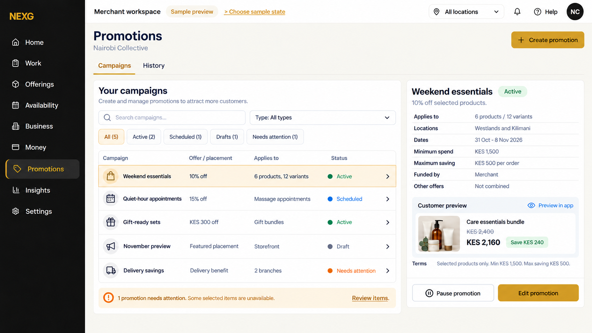
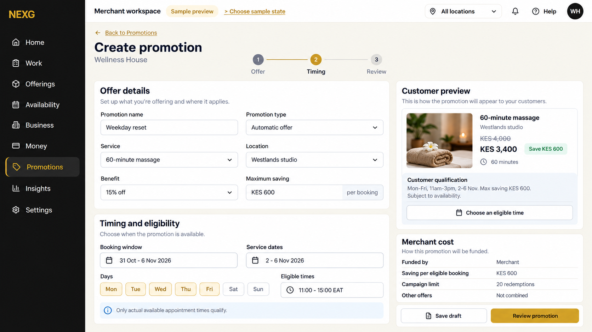
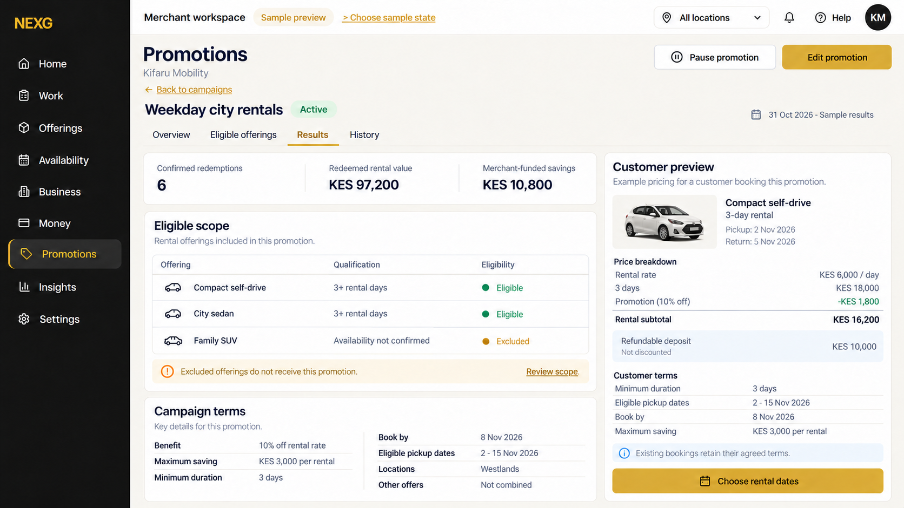
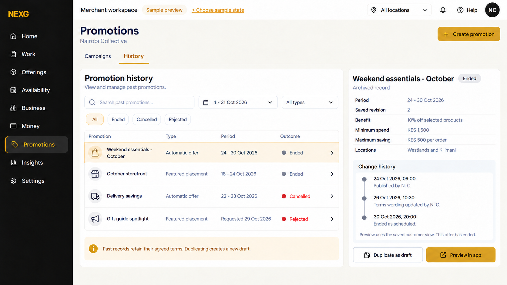
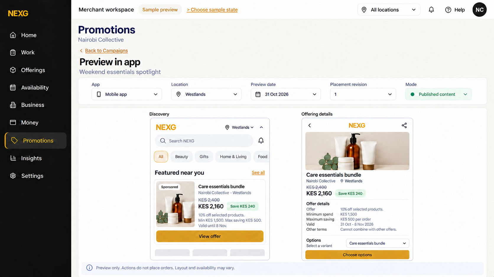

# Promotions concept images

Five selected states of one adaptive screen. Page tabs are Campaigns and History only. Featured placement is a campaign type in the shared list, not another destination. All content is fictional sample data. The [full screen design](screen-design.md) and [all-128 coverage](coverage-128.md) describe behavior beyond these images.

## Unified campaigns

Revised: Campaigns and History only, a Type filter, compact status filters and Preview in app. The page-level status summary strip remains removed.

## Create a service offer

## Rental campaign management and results

## Promotion history

Past outcomes, saved revision and audit timeline. Preview in app uses the saved historical view.

## Preview in the customer app

The merchant sees the discovery card and offering details with location/date/revision context and Back to Campaigns.

[Image review](image-review.md), [prompts](image-prompts.json), [correction prompt](image-3-correction-prompt.txt) and [provenance](image-manifest.json).
